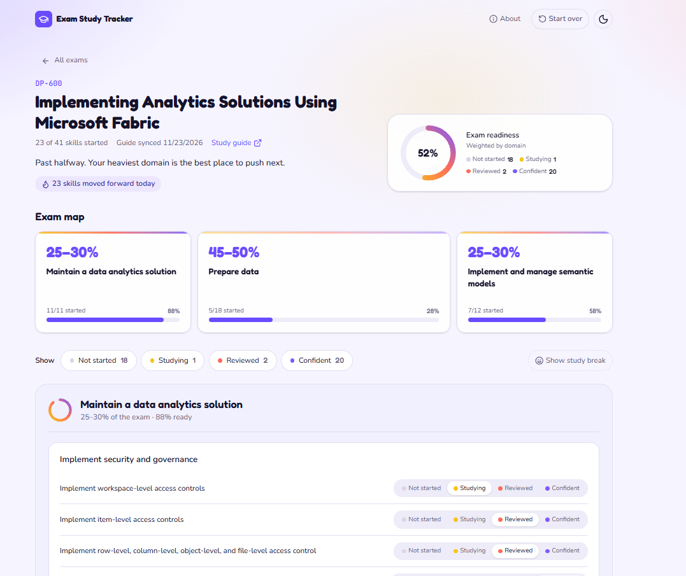

# MS Exam Study Tracker

A Microsoft Fabric App that turns any Microsoft Learn exam study guide into a visual study tracker.

Pick an exam (DP-600, DP-700, DP-800, PL-300, or any other Microsoft exam with a study guide), see how the exam is weighted, and mark each skill as you study. The app shows how ready you are, weighted the same way the exam is.

Built by [Shabnam Watson](https://www.linkedin.com/in/shabnamwatson/) with [Microsoft Fabric Apps](https://learn.microsoft.com/en-us/fabric/apps/overview) (preview).

<picture>
  <source media="(prefers-color-scheme: dark)" srcset="docs/images/home-dark.png">
  
</picture>

## What it does

- **Exam map.** Each domain is a tile sized by its exam weight, so you can see at a glance where the points are.
- **Track every skill.** Mark each skill as *Not started*, *Studying*, *Reviewed* or *Confident*. Filter the list by status.
- **Readiness score.** A progress ring shows how ready you are, weighted by domain the same way the exam is.
- **Small rewards.** Celebrations when you master a section, a domain or a readiness milestone, plus an optional "study break" panel with clean data and office jokes.
- **Start over.** Reset all your progress, with an "Are you sure?" check first.
- **Private progress.** You sign in with your Fabric account, and each person only sees their own progress.



## How it works

```text
Microsoft Learn study guides
        │  (web pages)
        ▼
Fabric notebook: SyncExamStudyGuides      run it when you like, or schedule it daily
        │  writes two Delta tables
        ▼
Lakehouse: ExamCatalog                    exams, exam_skills
        │  read-only connector (SQL analytics endpoint)
        ▼
Fabric App: MS Exam Study Tracker  ◀──▶  App database: your progress (MyExam, SkillProgress)
```

> [!IMPORTANT]
> **The official study guide comes first.** The Microsoft Learn study guide is the official source for every exam, so always check it before your exam. This app reads those pages automatically, so it may contain errors, or stop updating if Microsoft changes how the study guide pages are laid out.

## What you need

- A **Microsoft Fabric workspace** on a capacity where **Fabric Apps (preview)** is available, and permission to create items in it.
- **Node.js 22 or 24 (LTS)** and **Git** on your computer. Newer Node versions work but print an "unsupported engine" warning.
- About 20 minutes.

## Set it up in your own Fabric workspace

### 1. Create a workspace

In Fabric, create a workspace for the app, for example **Exam Study Tracker**. Remember the name; you'll use it when you deploy.

### 2. Create the lakehouse

In that workspace, select **New item → Lakehouse** and name it **ExamCatalog**. The **Lakehouse schemas** option can stay on.

### 3. Load the exam skills with the notebook

1. In the workspace, select **Import → Notebook → From this computer**, and pick [`notebooks/SyncExamStudyGuides.ipynb`](notebooks/SyncExamStudyGuides.ipynb) from this repo.
2. Open the notebook. In the **Explorer** pane, add the **ExamCatalog** lakehouse and make it the default lakehouse.
3. Optional: in the last cell, edit the `EXAMS` list to the exams you want, for example `EXAMS = ["DP-600", "DP-700", "DP-800", "PL-300"]`.
4. Select **Run all**. When it finishes, the lakehouse has two tables: `exams` and `exam_skills`.
5. Optional: schedule the notebook to run daily (**Run → Schedule**) so the skills stay in step with any changes to the study guides.

### 4. Get the code

```bash
git clone https://github.com/ShbWatson/ms-exam-study-tracker.git
cd ms-exam-study-tracker
npm install
```

`npm install` prints a few warnings (deprecated packages, `npm audit` findings, install scripts). They come from the Fabric Apps template's tooling and are safe to ignore. Don't run `npm audit fix --force`; it can upgrade packages to versions that break the app. If `npm install` stops with a peer dependency (`ERESOLVE`) error, run `npm install --legacy-peer-deps` instead.

### 5. Connect the app to your lakehouse

The app reads the exam list through a read-only connector to the lakehouse's **SQL analytics endpoint**. Its settings live in [`rayfin/rayfin.yml`](rayfin/rayfin.yml), which points at two values you keep in `rayfin/.env`. That file is ignored by git, so your IDs never end up on GitHub.

> [!IMPORTANT]
> The connector needs the ID of the **SQL analytics endpoint**, not the lakehouse. Fabric creates both when you create the lakehouse, with the same name (ExamCatalog) and different IDs. Using the lakehouse ID makes the deploy fail with "Source attachment failed".

1. **Find the SQL analytics endpoint ID.** In the SyncExamStudyGuides notebook, add a cell and run:

   ```python
   import sempy.fabric as fabric

   display(fabric.list_items(type="SQLEndpoint"))
   ```

   Copy the **Id** of the row whose **Display Name** is **ExamCatalog**. After your first deploy, the list also shows a row named after your app; that one is the app's own database, so ignore it. The **Workspace Id** column has your workspace ID.

2. **Create `rayfin/.env`.** Create a file named `.env` in the `rayfin` folder (there's a sample in [`rayfin/env.example`](rayfin/env.example)) and add your two IDs, with no quotes or spaces:

   ```ini
   CATALOG_WORKSPACE_ID=<Workspace Id>
   CATALOG_SQL_ENDPOINT_ID=<ExamCatalog SQL endpoint Id>
   ```

   On Windows, `notepad rayfin\.env` creates and opens it.

The Rayfin CLI also writes its own settings to `rayfin/.env` when you deploy. It keeps your two lines.

### 6. Deploy to Fabric

```bash
npm run rayfin:up -- --item-name "MS Exam Study Tracker" --workspace "Exam Study Tracker"
```

Use your own workspace name if it's different. `npm run rayfin:up` runs this project's own copy of the Rayfin CLI (the `--` passes the rest to it), so an older Rayfin CLI installed globally on your computer can't get in the way.

The first run asks you to sign in to Fabric, then creates the app in your workspace and prints its address ("Your app is live at …"). At the end, check that the component results say **`connectors: success`**. Run the same command again to deploy later changes.

### 7. Try it locally (optional)

```bash
npm run dev
```

Then open http://localhost:5173. If port 5173 is busy, stop whatever is using it first; the app's sign-in only allows that port.

## Add another exam

Add the exam code to the `EXAMS` list in the notebook and run it again. For example, `"AZ-104"` or `"AI-102"`. Any Microsoft exam with a study guide at `learn.microsoft.com/credentials/certifications/resources/study-guides/<exam code>` should work. There's no app change and no redeploy: refresh the app and the new exam appears.

If a new exam doesn't show up right away, open the lakehouse's **SQL analytics endpoint** in Fabric and select **Refresh**, then refresh the app.

## Make it yours

The About page (the **About** link in the header) is about me, the person who built this. To change it, edit [`packages/frontend/src/study/about-content.ts`](packages/frontend/src/study/about-content.ts). All the wording, links and the photo are in that one file. Leave a link's `href` empty to hide that button.

## Project layout

```text
.
├── notebooks/
│   └── SyncExamStudyGuides.ipynb       # Reads the study guides into the ExamCatalog lakehouse
├── rayfin/
│   ├── rayfin.yml                      # App services and the read-only "catalog" connector
│   ├── env.example                     # Sample for rayfin/.env (your two IDs go there)
│   └── connectors/catalog/             # Exams and ExamSkills entities (lakehouse tables)
├── packages/
│   ├── data/                           # App database: MyExam, SkillProgress (owner-only)
│   ├── shared/                         # Types shared by the data package and the frontend
│   └── frontend/                       # React + Vite + Tailwind app
│       └── src/study/                  # The study tracker screens
└── scripts/                            # Fabric Apps template tooling
```

## Useful commands

| Command | What it does |
| --- | --- |
| `npm run dev` | Runs the app locally at http://localhost:5173 |
| `npm test` | Runs the tests |
| `npm run lint` | Checks the code style |
| `npm run typecheck` | Checks the TypeScript types |
| `npm run rayfin:up -- --item-name "…" --workspace "…"` | Builds and deploys the app to Fabric |

## Troubleshooting

- **The app shows "Couldn't load this from Fabric … No schema document exists for this artifact"**: the connector didn't apply. Scroll up in the deploy output; you'll see a `Connector "catalog" apply failed` warning and `connectors: warning`. The usual cause is the next item.
- **`Connector "catalog" apply failed … Source attachment failed`**: `CATALOG_SQL_ENDPOINT_ID` has the lakehouse ID (or another item's ID) instead of the ExamCatalog SQL analytics endpoint ID. Fix it in `rayfin/.env` (step 5) and run the **full** deploy again (step 6). `rayfin up connector apply` alone doesn't send changed IDs to the app.
- **`error: unknown option '--item-name'`**: an old Rayfin CLI (1.x) ran instead of the project's copy, usually one installed globally. Check with `npx rayfin --version`. Deploy with `npm run rayfin:up -- …` as in step 6, and remove the old one with `npm uninstall -g @microsoft/rayfin-cli`. If the old CLI already ran in your folder, it may have changed the Rayfin versions in `package.json`; run `git status`, and if `package.json`, `packages/frontend/package.json` or `package-lock.json` show as modified, restore them with `git checkout -- package.json packages/frontend/package.json package-lock.json`, delete `node_modules` and run `npm install` again.
- **`Environment variable 'CATALOG_WORKSPACE_ID' referenced in rayfin.yml … is not defined`**: create `rayfin/.env` with your two IDs (step 5).
- **`rayfin connector inspect --name catalog` fails with a 400 error**: expected. `inspect` reads `rayfin.yml` without filling in the `${…}` values from `rayfin/.env`. Use the deploy output and the app itself to check the connector instead.
- **The app opens but shows no exams**: run the notebook (step 3), then open the ExamCatalog SQL analytics endpoint in Fabric and select **Refresh**.
- **Percentages look garbled (`10–15%`)**: you're using an old copy of the notebook. Use the one in this repo, which reads the pages as UTF-8.
- **The notebook fails on an exam**: Microsoft may have changed that study guide page. The other exams still sync. Check the official study guide, and open an issue here.

## Built with

- [Microsoft Fabric Apps](https://learn.microsoft.com/en-us/fabric/apps/overview) (preview) and the Rayfin CLI and SDK
- A Fabric notebook and lakehouse for the exam catalog
- React, Vite, Tailwind CSS, Framer Motion and Lucide icons

## License

[MIT](LICENSE). This project started from the Microsoft Fabric Apps universal-app template, which is also MIT licensed.
